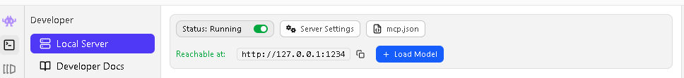

# LordBlack Harness

A fully local, privacy-first AI orchestration platform. Run one or more local LLMs through **LM Studio**, **Ollama**, or **llama.cpp**, give those models their own **persistent memory**, build and host **agents** — and, only when you explicitly enable it, let a local model delegate sub-tasks to external APIs (OpenRouter / Claude / GPT) and fold the results back into its answer.

Everything works **completely offline** once your models are downloaded. Cloud APIs are an opt-in enhancement, never a dependency.

Designed to run acceptably on low-end hardware: **Intel i3-class CPU, no dedicated GPU, 4–8 GB RAM.**

---

## What it does

| Feature                         | How it works                                                                                                                                                                                                                                                                                                                                              |
| ------------------------------- | --------------------------------------------------------------------------------------------------------------------------------------------------------------------------------------------------------------------------------------------------------------------------------------------------------------------------------------------------------- |
| **Local runtime connectivity**  | Normalized `LocalModelProvider` interface over LM Studio (`:1234/v1`), Ollama (`:11434`), llama.cpp server (`:8080`), or embedded llama.cpp (optional `llama-cpp-python`)                                                                                                                                                                                 |
| **Harness Memory**              | Your private knowledge store: add / edit / delete / upload `.md`/`.txt` notes. Files are chunked, embedded (when possible), and the top matching chunks are injected into each prompt — so the model searches memory instead of exhausting its context window. Built on a single SQLite file + pure-Python BM25 + optional embeddings; no heavy vector DB |
| **Agentic external delegation** | In *Agentic Mode*, the local model decides whether a sub-task needs a stronger model, picks a suitable **currently-free** OpenRouter model (or Claude/GPT), calls it, extracts only the relevant part, and answers with it. Every step is visible in the AI Activity trace                                                                                |
| **Local-to-local chat (Duet)**  | Two local models collaborate on one answer: one drafts, the other critiques and refines                                                                                                                                                                                                                                                                   |
| **Agent builder + hosting**     | Define agents as JSON manifests (system prompt, model, tools, trigger), run them manually or on a schedule, and host them at `http://localhost:8765/agents/<name>/chat` for other local tools (LAN optional)                                                                                                                                              |
| **Scoped folder access**        | Grant specific folders only; toggle individual files into the model's working context; "Apply to File" / "View Diff" actions when the model proposes edits (a `.lbk.bak` backup is kept)                                                                                                                                                                  |
| **Privacy enforcement**         | Cloud models *cannot read Harness Memory* — enforced at the routing layer. Keys encrypted at rest (Windows DPAPI / Fernet). Internet toggle makes all external code paths inert                                                                                                                                                                           |

## Hardware & software prerequisites

- **OS:** Windows 10/11, Linux, or macOS
- **Python 3.10+** ([python.org](https://www.python.org/downloads/) — on Windows, check *"Add python.exe to PATH"* during install)
- **One local runtime**, any of:
  - **LM Studio** ([lmstudio.ai](https://lmstudio.ai)) — easiest; load any chat model (a 3–4B quantized model like *Qwen2.5-3B-Instruct Q4* runs well on 4–8 GB RAM)
  - **Ollama** ([ollama.com](https://ollama.com)) — `ollama pull qwen2.5:3b`
  - **llama.cpp** `llama-server` — any GGUF model
- A modern browser (Chrome/Edge/Firefox)

> No GPU needed. No Docker. No Node.js. No build step.

## Installation (super easy)

1. **Clone or download + unzip** this repository.

2. **Run the launcher:**
   - Windows: double-click **`run.bat`**
   - Linux/macOS: `chmod +x run.sh && ./run.sh`
   
   First run creates a private Python environment, installs dependencies (needs internet **once**), starts the backend, and opens the UI in your browser at `http://127.0.0.1:8765`.

3. **Connect your runtime:** go to **Settings → Model & API Integrations**, paste the URL shown in LM Studio's **Developer** mode under *"Reachable at"*, then click **Connect**.

   

   *(Or just use the welcome dialog on first launch — it does the same thing.)*

4. **Start chatting.** Type in the workspace input bar. Your model answers with streaming tokens; the AI Activity panel shows every pipeline step.

5. **Optional — external delegation:** add an API key for **OpenRouter** (free models are preferred automatically), **Claude**, or **GPT** in *Settings → Model & API Integrations* or the *Cloud* page, enable **Internet access** in *Settings → Security*, then flip **Agentic Mode** on in the chat input bar.

## Everyday usage

- **Memory:** *Memory* page → add notes or upload `.md` files. Keep the **RAG Memory** chip on in the chat bar; the *Memory Retrieval* panel (workspace, left column) shows exactly which facts were pulled into context each turn.
- **Folder access:** *Workspace → FILE ACCESS → +* — grant a folder, expand the tree, toggle files into context. The model only ever sees what you grant.
- **Duet Mode:** pick a partner model in *Settings → General* or the ★/◎ controls in *Model Hub*, then flip **Duet Mode** on.
- **Agents:** *Node Networks* page → **+ New agent**. Choose its model, tools (memory search/write, read files, external lookup, bluetooth scan), trigger (manual or scheduled) and hosting. Hosted agents are callable:
  ```bash
  curl -X POST http://127.0.0.1:8765/agents/my-agent/chat \
       -H "Content-Type: application/json" -d '{"message": "summarize todays notes"}'
  ```
- **Command palette:** `Ctrl+K` (or `/`) — jump anywhere, toggle internet, create notes/agents, start a new chat.
- **New Chat:** the **+ New Chat** button in the chat header starts a fresh conversation (clears the thread only — your memory notes stay).
- **Offline mode:** leave *Settings → Security → Internet access* **off**. Then nothing can leave your device — all cloud paths are inert, not merely discouraged.

## Troubleshooting (first run)

| Problem                                             | Fix                                                                                                                                                                                                                                                           |
| --------------------------------------------------- | ------------------------------------------------------------------------------------------------------------------------------------------------------------------------------------------------------------------------------------------------------------- |
| **"Cannot reach harness backend"**                  | The UI must be served by the backend. Run `run.bat` / `run.sh` (don't just double-click `index.html` — the page tells you this too). Check the console window for Python errors.                                                                              |
| **Connect fails / NOT CONNECTED**                   | In LM Studio: **Developer** tab → toggle the **Local Server** *Status: Running* switch. Confirm the URL matches *"Reachable at"* (e.g. `http://127.0.0.1:1234`). Ollama must be running (`ollama serve` or the menu-bar app).                                 |
| **Connected but no models detected**                | Load a model in LM Studio (and enable *Just-in-Time model loading* in its server settings if you like), or pull one in Ollama (`ollama pull qwen2.5:3b`). Then *Model Hub → Refresh models*.                                                                  |
| **Memory search says "keyword (BM25 fallback)"**    | That's fine — it's the lightest mode. For semantic search, load an embedding model in LM Studio (e.g. `nomic-embed-text`) so "runtime embeddings" engages automatically, or install `onnxruntime` + `tokenizers` and download MiniLM in *Settings → General*. |
| **Slow on a 4 GB machine**                          | Use a 3–4B quantized model (Q4_K_M), keep *Memory chunks per query* at 2–4, keep chunk size ~600, avoid Duet + Agentic at once.                                                                                                                               |
| **Agent hosting not reachable from another device** | Enable *Settings → General → Allow LAN access* and restart. Only do this on trusted networks.                                                                                                                                                                 |

## Privacy summary — what never leaves your device

- Harness Memory, chat history (in-session), granted-folder files, agent manifests, logs, the SQLite DB — **all local, under `data/`.**
- Cloud providers receive **only the self-contained sub-task text** your local model composed for delegation — never memory chunks, never your files, never the conversation. The memory-search tool doesn't exist in any cloud call's toolset; the boundary is enforced by construction at the routing layer.
- API keys are encrypted at rest (Windows DPAPI; Fernet elsewhere) and always masked in the UI.
- The **Internet access** toggle is a hard gate: off means zero external requests from the harness.
- Every external call is timestamped and visible in the **AI Activity** trace.

## Project structure

```
lordblack-harness/
├── run.bat / run.sh          # one-click launcher (creates .venv, installs deps, starts app)
├── app.py                    # starts the backend + opens the UI
├── requirements.txt          # 5 small core deps; optional extras commented out
├── backend/
│   ├── main.py               # FastAPI: REST + SSE routes, hosts static UI
│   ├── config.py             # settings persistence + encrypted API keys (DPAPI/Fernet)
│   ├── pipeline.py           # chat pipeline: RAG, agentic delegation, duet, traces
│   ├── providers/
│   │   ├── local.py          # LM Studio / Ollama / llama.cpp (server + embedded)
│   │   └── cloud.py          # OpenRouter / Anthropic / OpenAI
│   ├── memory/
│   │   ├── store.py          # SQLite chunks, hybrid vector+BM25 retrieval
│   │   └── embeddings.py     # runtime / MiniLM-ONNX / keyword backends
│   ├── agents.py             # manifests, tool loop, scheduler, hosting, rate limits
│   ├── fsaccess.py           # granted-folder sandbox (read/write/diff/pick)
│   ├── logs.py               # rotating log + live SSE stream + trace ring
│   └── sysinfo.py            # CPU/RAM sampler (SSE, no client polling)
├── frontend/                 # plain HTML/CSS/JS — no build step
│   ├── index.html
│   ├── css/                  # base, workspace, pages
│   └── js/                   # api (SSE client), workspace, modelhub, cloud,
│                             # memory, agents, logs, settings, app
├── data/                     # created at runtime: config.json, harness.db,
│                             # memory/*.md, agents/*.json, logs/
└── docs/
```

## Notes & limits (v1)

- Chat history lives in the session (refresh clears it) — Harness Memory is the persistence layer by design.
- "Node Networks" hosts agents; multi-agent *meshes* (agent-to-agent messaging) are on the roadmap.
- VRAM readout requires an NVIDIA GPU with `pynvml`; otherwise it shows `n/a`.
- Non-goals for v1: mobile UI, multi-user, any cloud-hosted deployment.

## License

MIT — see [LICENSE](LICENSE).
